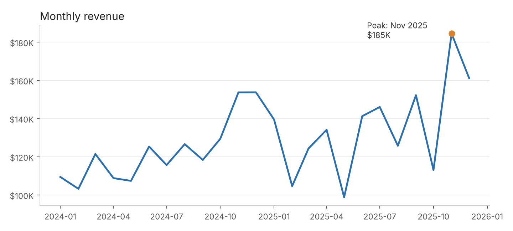
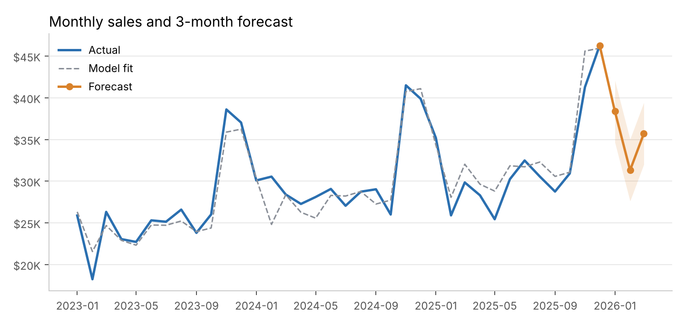
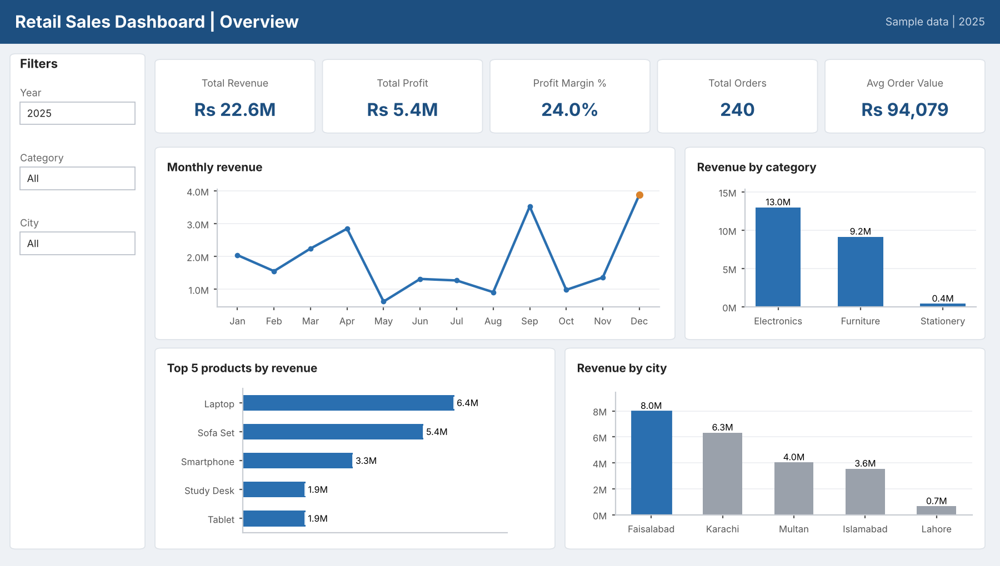
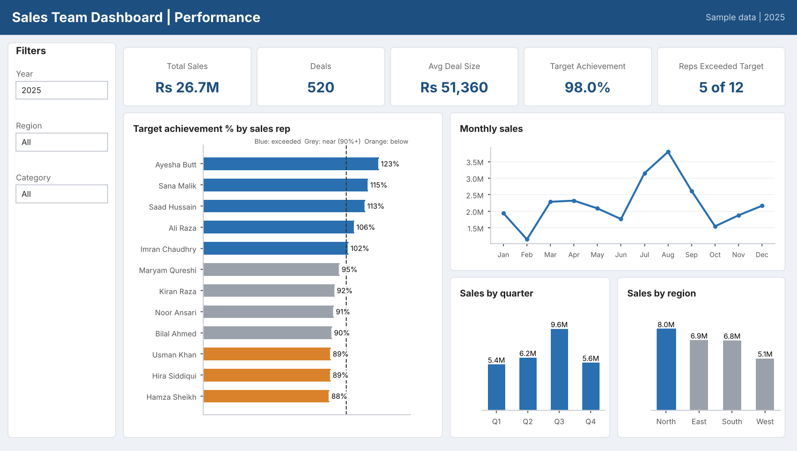

# Data Analytics Portfolio

**Syed Hamza Ali**

Six sales-analysis projects built after completing a data analytics course: two in **Python**, two in **SQL** and two in **Power BI**. Each project has a PDF report with the analysis, a sales list and the full code.

> **Note on data:** All projects use **sample (synthetic) data** created for learning and practice. The numbers do not belong to a real company.

## Skills shown

| Area | Tools and techniques |
|---|---|
| Python | pandas, NumPy, matplotlib, ReportLab; data cleaning, aggregation, RFM segmentation, trend + seasonality forecast with back-test |
| SQL (SQLite) | JOINs, GROUP BY, CTEs, window functions (`RANK`, `ROW_NUMBER`, `LAG`, running totals), `CASE`, subqueries, `NOT EXISTS` |
| Power BI | Star-schema data model, Power Query (M), DAX measures, time intelligence, 2-page dashboards |

---

## Python

### 1. Sales Analysis
Cleans an orders dataset and analyses revenue, profit, products, regions and discounts, then builds a PDF report with charts.

- Revenue grew **10.3%** from 2024 to 2025 with a **27.7%** profit margin across 4,383 orders.
- Laptop is the best-selling product (**38%** of revenue); November and December run about **33%** above the other months.
- Bigger discounts lower profit per order without raising the quantity sold.



Files: [`python/01-sales-analysis`](python/01-sales-analysis) (code + PDF report)

### 2. Customer Segmentation (RFM) and Sales Forecast
Groups 798 customers by Recency, Frequency and Monetary value, and forecasts the next 3 months of sales.

- **Champions** are 27% of customers but bring **66%** of revenue.
- **At Risk** customers (158) hold $205K in past sales, so they are the first win-back target.
- Trend + seasonality forecast with a back-test error of **7.1%**.



Files: [`python/02-customer-segmentation-forecast`](python/02-customer-segmentation-forecast) (code + PDF report)

---

## SQL

### 1. Retail Sales Database
Four related tables (customers, products, orders, order items) and 7 business queries: KPIs, monthly growth with running total, top products, category margin, city ranking, top customers and customers who never ordered.

- Revenue **Rs 22.6M** from 240 orders, margin **24.0%**.
- The top 10 customers produce **71%** of revenue; 8 customers never ordered.

Files: [`sql/01-retail-sales-database`](sql/01-retail-sales-database) (`.sql` script + PDF report)

### 2. Sales Team and Inventory
Three tables (employees, products, sales) and 7 queries: rep performance against target, rank inside region, quarterly sales, best seller per category, stock alerts, weekday pattern and never-sold products.

- Sales of **Rs 26.7M**; **5 of 12** reps exceeded their annual target.
- 6 products are at or below reorder level; 1 product had no sales.

Files: [`sql/02-sales-team-inventory`](sql/02-sales-team-inventory) (`.sql` script + PDF report)

---

## Power BI

Each project includes a PDF with the data model, DAX measures, dashboard design, insights, Power Query (M) code and step-by-step build guide, plus the CSV files used.

### 1. Retail Sales Dashboard
Two pages: Overview (KPIs, monthly trend, category, top products, city) and Products and Customers (margin, discount effect, cumulative revenue, top 10 customers).



Files: [`powerbi/01-retail-sales-dashboard`](powerbi/01-retail-sales-dashboard)

### 2. Sales Team and Inventory Dashboard
Two pages: Sales Performance (target achievement by rep, monthly, quarterly and regional sales) and Products and Inventory (revenue by product, low-stock alert, weekday sales).



Files: [`powerbi/02-sales-team-inventory-dashboard`](powerbi/02-sales-team-inventory-dashboard)

> The dashboard images are design previews drawn from the same data. The step-by-step guide in each PDF explains how to build the dashboard in Power BI Desktop.

---

## How to run

**Python** (Python 3.9+)
```bash
pip install pandas numpy matplotlib reportlab
cd python/01-sales-analysis
python sales_analysis.py          # creates the data, charts and PDF report
```
Run `customer_forecast.py` the same way inside the second Python folder.

**SQL** (SQLite)
```bash
sqlite3 retail.db < sql/01-retail-sales-database/retail_sales.sql
```
Or open the `.sql` file in DB Browser for SQLite and run it.

**Power BI**
Open Power BI Desktop, load the CSV files from the project's `data` folder and follow the steps in the PDF.

## Project structure

```
Data-Analytics-Portfolio/
├── python/
│   ├── 01-sales-analysis/
│   └── 02-customer-segmentation-forecast/
├── sql/
│   ├── 01-retail-sales-database/
│   └── 02-sales-team-inventory/
├── powerbi/
│   ├── 01-retail-sales-dashboard/
│   └── 02-sales-team-inventory-dashboard/
└── images/
```
